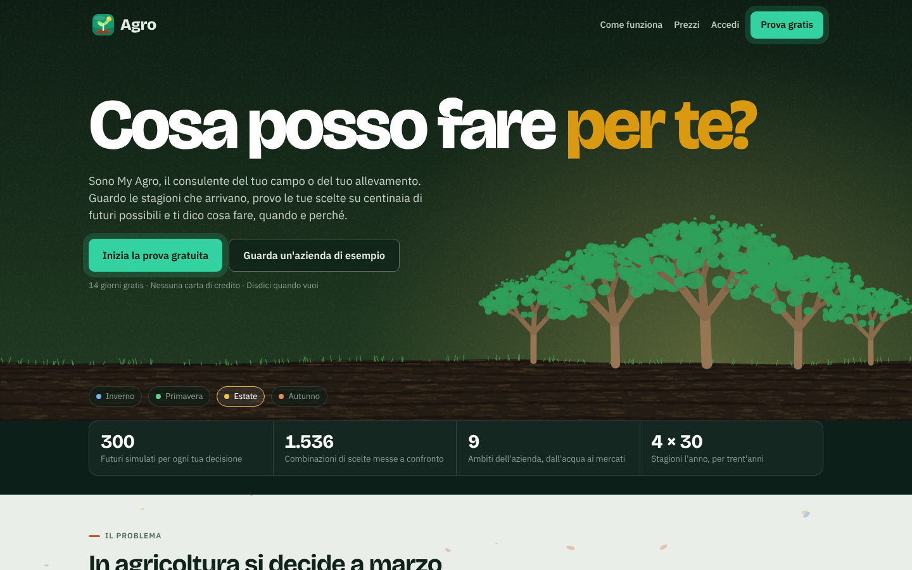
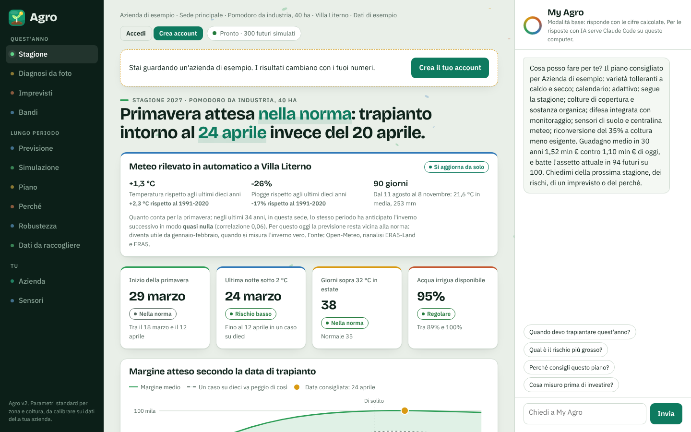
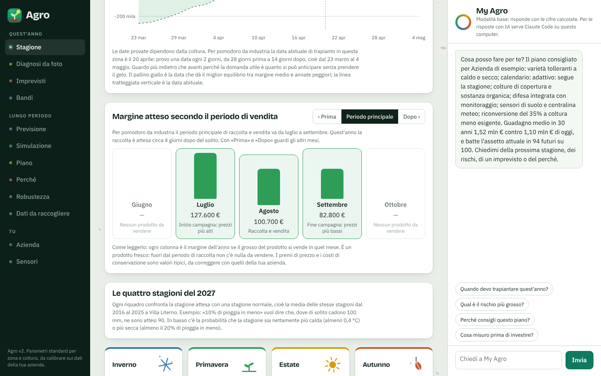
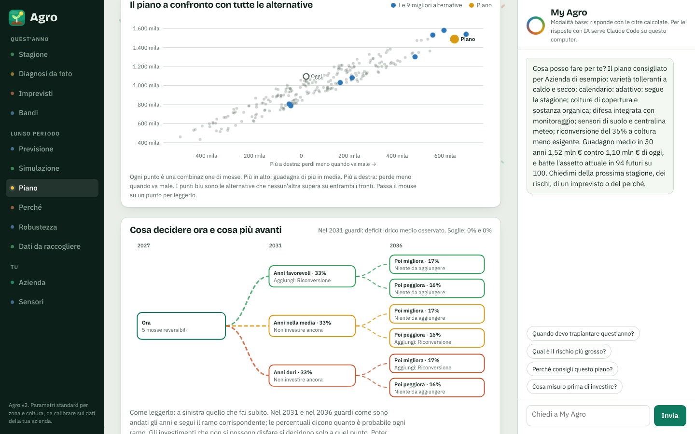
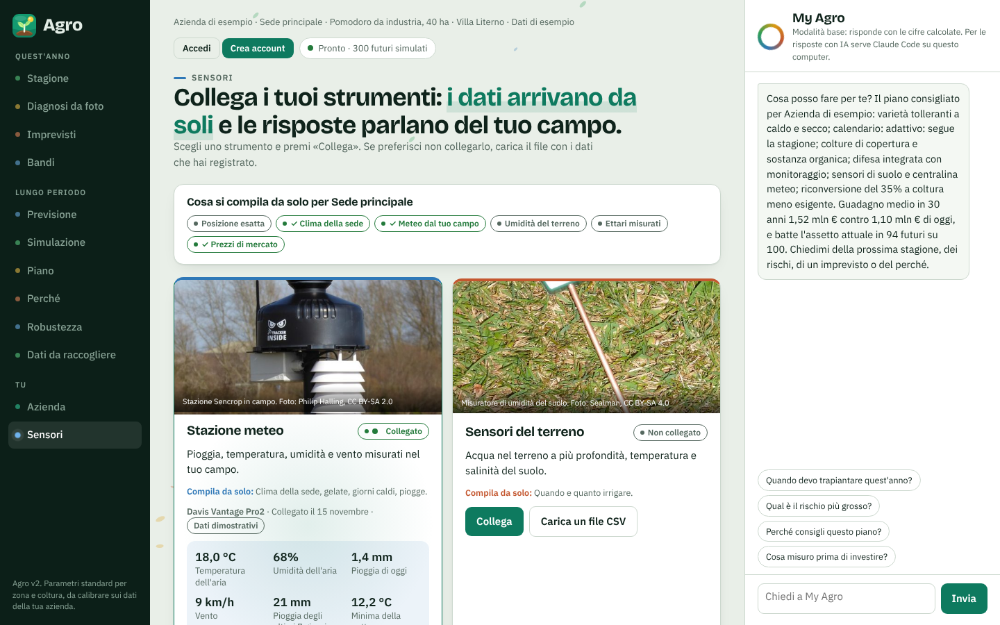
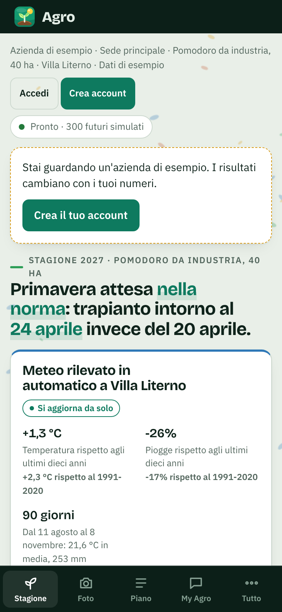

# Agro - Pianificazione agricola intelligente

Il consulente digitale per chi gestisce un campo o un allevamento.

Agro legge il clima della sede, simula centinaia di futuri possibili e dice cosa fare, quando e perché: dalla data di semina di quest'anno agli investimenti dei prossimi trent'anni. Al suo interno c'è **My Agro**, il consulente a cui si scrive come a una persona.

[**Prova Agro online**](https://myagrotech.netlify.app/)



> **Stato del progetto: prototipo dimostrativo.** L'applicazione funziona, ma iscrizione, pagamenti, richiesta di intervento del tecnico e collegamento in rete dei sensori sono simulati. Il modello non è stato validato su dati reali. I dettagli sono in [Limiti](#limiti).

## Cosa fa

| Scheda | A cosa serve |
| --- | --- |
| **Stagione** | Data consigliata di semina o trapianto, rischio di gelo, margine atteso per ogni data, periodo di vendita, quattro stagioni attese, cose da fare |
| **Diagnosi da foto** | Prima diagnosi da foto o video di piante, terreno o animali: problema, cause, controlli, cura |
| **Imprevisti** | Guida in tre tempi per grandine, gelata, incendio, alluvione e altri eventi, con stima del danno |
| **Bandi** | Ricerca dei contributi aperti e lettura di un bando per capire se l'azienda può partecipare |
| **Previsione** | Margine, rese e stagioni nei prossimi trent'anni se non si cambia nulla |
| **Simulazione** | Effetto di ogni scelta e di ogni investimento, provati a mano |
| **Piano** | La combinazione migliore tra 1.536, con investimenti a tappe |
| **Perché** | Quanto pesa ogni scelta e da cosa dipende il risultato |
| **Robustezza** | Tenuta del piano se il modello sbaglia, con prove di stress |
| **Dati da raccogliere** | Quali misure conviene fare prima di investire |
| **Azienda** | Dati dell'azienda e delle sedi: 38 colture, 14 tipi di allevamento |
| **Sensori** | Stazione meteo, sensori del terreno, GPS: collegamento dimostrativo e lettura di file reali |

| | |
| --- | --- |
|  |  |
|  |  |



## Avvio rapido

Serve [Node.js](https://nodejs.org) 18 o successivo. Non ci sono dipendenze da installare.

```bash
git clone <indirizzo-del-repository>
cd agro
node server.js
```

Poi apri <http://localhost:4747>. Su Mac basta un doppio clic su `Avvia Agro.command`.

Le istruzioni complete, comprese le funzioni di intelligenza artificiale e il collegamento pubblico, sono in [INSTALLAZIONE.md](INSTALLAZIONE.md).

## Com'è fatto

Agro è una pagina web servita da un piccolo server locale. Il modello gira nel browser, in un processo separato dalla pagina.

```
agro/
├── index.html              Pagina unica: presentazione, iscrizione, applicazione
├── style.css               Aspetto, temi chiaro e scuro, versione telefono
├── app.js                  Interfaccia, grafici, My Agro, sensori, account
├── model.js                Motore di calcolo: simulazione e ottimizzazione
├── server.js               Server locale senza dipendenze
├── fonts/                  Caratteri (Bricolage Grotesque, IBM Plex Sans)
├── img/                    Foto della sezione Sensori, con crediti
├── dati/                   Creata al primo avvio; non entra nel repository
├── Avvia Agro.command      Avvio su Mac con doppio clic
├── Condividi Agro.command  Link pubblico temporaneo (Cloudflare Tunnel)
└── docs/
    ├── modello.md                  Come funziona il calcolo
    ├── business-plan/              Business plan 2027-2029
    ├── nota-interna.pdf            Il progetto spiegato in modo semplice
    ├── spiegabilita/               Guida: diagnosi spiegabile delle piante malate
    └── schermate/                  Immagini di questo documento
```

### Il modello, in breve

- 300 futuri simulati di 30 anni, quattro stagioni l'anno, su tre scenari di emissioni.
- 1.536 combinazioni di scelte: sei mosse reversibili e quattro investimenti.
- Piano a tappe (2027, 2031, 2036), prove di robustezza, valore dei dati da raccogliere.
- Clima di partenza letto dalla storia 1991-2025 della sede; variabilità dei prezzi da Eurostat.

La descrizione completa è in [docs/modello.md](docs/modello.md).

### Servizi esterni

| Servizio | Uso | Nota |
| --- | --- | --- |
| [Open-Meteo](https://open-meteo.com) | Clima storico, ultimi 90 giorni, previsione a 16 giorni, coordinate dei comuni | Il livello gratuito non è per uso commerciale |
| [Eurostat](https://ec.europa.eu/eurostat) | Prezzi agricoli alla produzione | Solo per alcune colture |
| [VIES](https://ec.europa.eu/taxation_customs/vies) | Ragione sociale dalla partita IVA | |
| Claude Code | My Agro, diagnosi da foto, bandi | Facoltativo: senza, il resto funziona |

## Limiti

- **Modello non validato.** L'andamento futuro del clima e la risposta di colture e animali sono ipotesi scelte a mano. I risultati servono a ragionare sulle scelte, non sono previsioni verificate.
- **Parametri standard.** Rese, prezzi e costi di partenza di colture e allevamenti sono stime da correggere con i numeri dell'azienda.
- **Funzioni simulate.** Iscrizione, mail, pagamento, richiesta del tecnico Agro e collegamento in rete dei sensori non fanno nulla di reale. I dati dei sensori collegati sono segnati «Dati dimostrativi» e non entrano nei calcoli.
- **Funzioni reali.** Lettura dei file CSV di stazioni e sensori, confini dei campi (GeoJSON, KML), GPS del dispositivo, clima, prezzi, partita IVA.
- **Diagnosi e trattamenti.** La diagnosi da foto è un primo orientamento. Non sostituisce un sopralluogo né la prescrizione di un tecnico abilitato.
- **Bandi.** La verifica dei requisiti è preliminare e va controllata sul testo ufficiale.

## Documenti

- [Business plan 2027-2029](docs/business-plan/Agro_Business_Plan_2027-2029.pdf)
- [Nota interna sul progetto](docs/nota-interna.pdf)
- [Diagnosi spiegabile delle piante malate](docs/spiegabilita/diagnosi-piante-spiegabile.md)
- [Come funziona il modello](docs/modello.md)

## Crediti

Caratteri, foto e fonti dei dati sono elencati in [CREDITI.md](CREDITI.md).

## Licenza

Nessuna licenza è stata ancora scelta: in questa forma tutti i diritti sono riservati. Prima di rendere pubblico il repository va aggiunto un file `LICENSE`.
